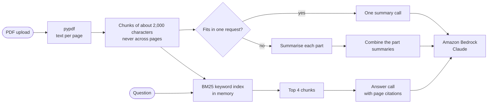

# PDF Summariser and Chatbot (Amazon Bedrock)


Upload a PDF, get a short summary with page citations, then ask questions about it. Text extraction and search run locally. Only the summary and answer steps call Amazon Bedrock (Claude) in your AWS account.

Built with Python, pypdf, Streamlit and the Bedrock Converse API.

## How it works



## Demo

> **Screenshot and demo video:** _placeholder. Record a summary and two questions on a public PDF (for example an annual report) and add them here._

## Design decisions

- **Page citations you can check.** Chunks never cross a page boundary, so every answer can say `[p. N]` and the app lists the source pages.
- **No vector database.** For one document, BM25 keyword search is fast, free and easy to explain. Swap in embeddings (for example Amazon Titan Embeddings) if questions need semantic matching.
- **Long documents.** If the text does not fit one request, the app summarises parts and then combines them (map-reduce).
- **Prompt injection.** The document goes inside `<document>` tags and the system prompt says to treat it as data and to answer from the document only. If search finds nothing, the model is not called.
- **Clear limits.** Password-protected PDFs, scanned PDFs without text, and PDFs over 300 pages get a clear error.

## Run it

Requirements: Python 3.12, AWS credentials, and Bedrock model access for the model (Bedrock console, Model access).

```bash
python -m venv .venv && source .venv/bin/activate
pip install -r requirements.txt
export AWS_REGION=us-east-1
export BEDROCK_MODEL_ID=us.anthropic.claude-haiku-4-5-20251001-v1:0   # check the ID for your region
streamlit run app.py
```

With Docker:

```bash
docker build -t pdfbot .
docker run --rm -p 8501:8501 -e AWS_REGION -e AWS_ACCESS_KEY_ID -e AWS_SECRET_ACCESS_KEY -e AWS_SESSION_TOKEN pdfbot
```

## Tests

```bash
pip install -r requirements-dev.txt
pytest --cov=pdfbot
```

The tests build real PDFs with fpdf2 and use a fake model, so no AWS account is needed.

## Cost

Bedrock charges per input and output token. A summary sends the whole document once (twice for long documents); a question sends only the top 4 chunks. Check the Bedrock pricing page for your model.
